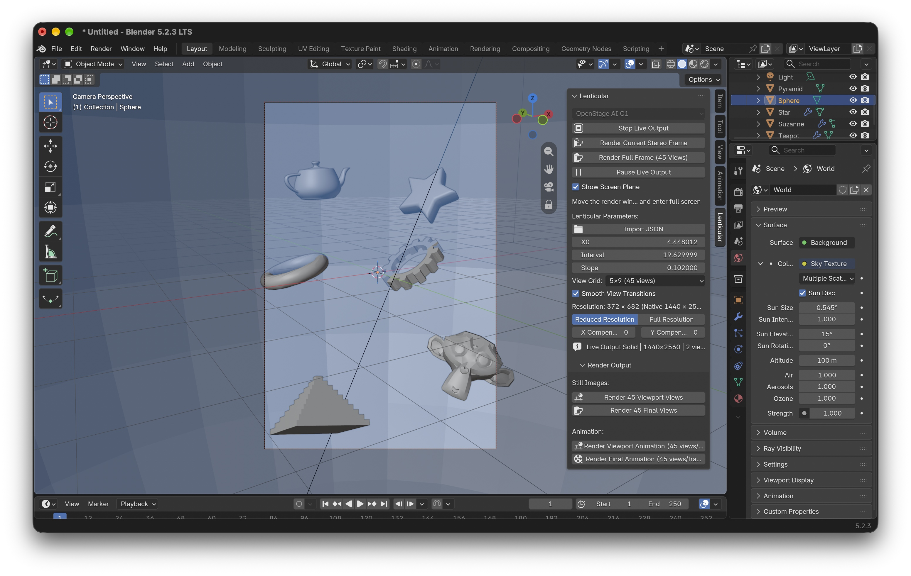
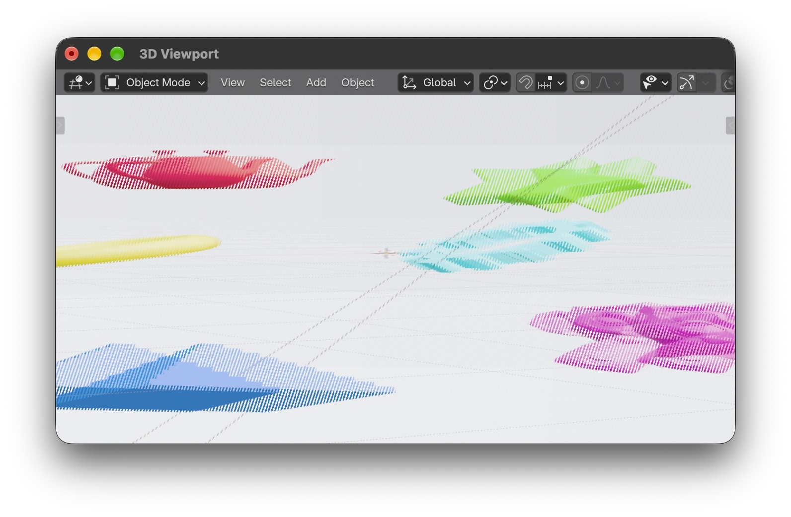

# OpenGlass-Lenticular

[](https://www.gnu.org/licenses/gpl-3.0)  

Unofficial open-source Blender 5.2+ extension for live lenticular 3D viewport preview and multiview still/animation export. It works standalone on both Windows and macOS without any bridge app.

Supports both **Looking Glass Go** and **OpenStage AI C1**.




## AI usage

This add-on and its companion scripts are developed primarily with AI assistance and tested on real hardware, with human design review and verification.

After all, it's vibe-coded. Don't use it if you don't trust it.

## Install

Download [`lenticular.zip`](https://github.com/megabitsenmzq/OpenGlass-Lenticular/releases) from the Releases page, then install it in Blender as a plugin or extension.

## Usage

### Setup

Open the 3D Viewport sidebar (`N`) and switch to the "Lenticular" tab. Choose your target device and fill in calibration data if prompted. 

Looking Glass Go calibration can be auto-detected and filled in automatically. For OpenStage AI C1, you need to enter it manually (you can copy these values by right-clicking in the official app).

Click "Start Live Output" to open the live window, then move it to the device's screen and enter full screen.


### Live Preview

In "Wireframe" and "Solid" modes, the extension renders a 2-view image in real time while moving the viewport, and refines it to 10 views after about 0.3 seconds.

In "Material Preview" and "Rendered" modes, a 2-view image is rendered automatically after a short delay once you stop moving the viewport.

Click the "Render Full Frame" button; the extension will render the image with all views, as chosen in "View Grid".

A blue overlay shows the screen plane: anything behind it appears inside the screen, and anything in front of it pops out.

### Focus

screen plane is set to your rotation point by default. In camera view, if you have a focus object or focus distance set, the screen plane will follow. You don't need to set up a separate camera.

### Export

Export will use your current state. In the viewport, it will render the viewport. In camera view, it will render the camera.

"Still Image" buttons will render a single frame. "Animation" buttons will render all the frames. This might take a long time. Please be patient. Most of the time, "Reduced Resolution" is good enough.

## Build

```sh
blender --command extension validate .
blender --command extension build --source-dir . --output-filepath ../lenticular.zip
```

## Related Projects

- [OpenGlass-Go-Builder](https://github.com/megabitsenmzq/OpenGlass-Go-Builder) — Unofficial open-source ARM64 firmware and reproducible image builder for the Looking Glass Go.
- [OpenGlass-Go-Apps](https://github.com/megabitsenmzq/OpenGlass-Go-Apps) — Native DRM/KMS menu, 3D media player, and STM32 MCU utility for OpenGlass Go firmware.

## Disclaimer

This project is an independent, unofficial third-party Blender add-on. It is **not affiliated with, endorsed by, sponsored by, or supported by Looking Glass Factory**, **OpenStage AI**, **CubeVi**, or the official Looking Glass / OpenStage software and firmware teams.

All product names, trademarks, and registered trademarks (including "Looking Glass", "Looking Glass Go", "OpenStage AI", "C1", and "Blender") are the property of their respective owners and are used strictly for compatibility and identification purposes.

This software is provided **"AS IS"**, without warranty of any kind, express or implied. You assume full responsibility for any risks associated with installing or using this software.

## License

This project is licensed under the **[GNU General Public License v3.0 or later (GPL-3.0-or-later)](https://www.gnu.org/licenses/gpl-3.0)**. See [`LICENSE`](./LICENSE).
